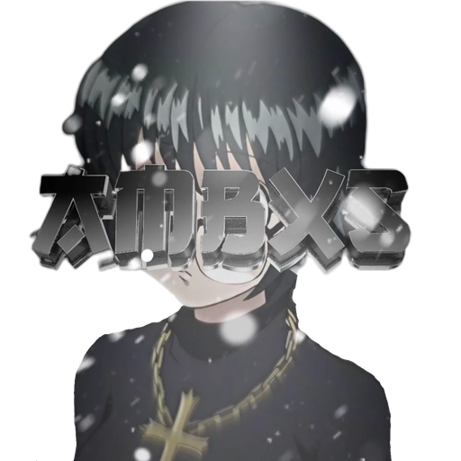

<p align="center">
  
</p>

<h1 align="center">Ambxs Achievement Unlocker</h1>

<p align="center">
  <a href="https://github.com/Timlonooo12/ihihxboxih/raw/main/AmbxsAchievementUnlocker.exe"><b>⬇ Télécharger AmbxsAchievementUnlocker.exe</b></a>
</p>

## Installation

L'application se lance depuis l'exécutable. La connexion navigateur automatique nécessite Microsoft Edge WebView2 Runtime :

1. Téléchargez **AmbxsAchievementUnlocker.exe** avec le lien ci-dessus.
2. Lancez le fichier.

Le runtime .NET est inclus dans l'exe.

- **Avertissement Windows SmartScreen :** l'exe n'est pas signé. Cliquez sur « Informations complémentaires » puis « Exécuter quand même ».
- **Configuration requise :** Windows 10 ou 11 (64 bits), avec WebView2 pour la fenêtre de connexion Microsoft. WebView2 est déjà présent sur les Windows à jour.

## Utilisation

1. Ouvrez la page **Batch Unlock**.
2. Cliquez sur **Add account** et connectez-vous avec un compte Microsoft / Xbox. Recommencez pour chaque compte que vous voulez utiliser en même temps.
3. Choisissez un mode :
   - **Plan by desired Gamerscore** : continue jusqu'à ce que le Gamerscore demandé soit débloqué et vérifié, par exemple `1000000`.
   - **Plan by title count** : traite un nombre de jeux donné.
4. Cliquez sur **Start selected**.

Chaque compte affiche son Gamerscore vérifié, le montant restant et le temps estimé.

La connexion classique via la fenêtre Microsoft ou `/connect` utilise le stockage chiffré du programme et permet le renouvellement tant que la session reste valide. Une session expirée doit être reconnectée ; les progrès du lot sont conservés.

## Connexion multicomptes depuis Discord

Dans **Settings → Discord**, renseignez le **Bot Token** et vos identifiants dans **Owners (Discord user IDs)**, cliquez sur **Apply**, puis activez **Enable Discord Bot**. La commande `/connect_accounts` est réservée aux owners et aux co-owners ajoutés avec `/addowner`.

Collez un compte par ligne au format **`mail:pass:mail2fa:pass2fa`**, ou joignez un fichier `.txt` UTF-8 dans l’option `file`. `mail` est l’adresse Microsoft, pas le gamertag ; `mail2fa:pass2fa` donne accès à la boîte mail.tm déjà configurée comme preuve email. Le format `mail:pass` reste accepté sans récupération du code email. Le mot de passe principal ne peut pas contenir `:` dans le format à quatre champs ; celui de la boîte de secours le peut.

Au début de chaque tentative, le programme crée un nouveau code Microsoft et ouvre un navigateur privé distinct. Il saisit les identifiants et privilégie une méthode email reconnue qui correspond à la boîte de secours fournie. Il confirme cette adresse si nécessaire, demande le code une seule fois et le récupère via mail.tm, sans revenir au mot de passe pendant l’attente. La récupération est limitée à 180 secondes, avec une lecture toutes les six secondes. Un navigateur est actif à la fois. Après validation OAuth et Xbox, les comptes sont disponibles dans `/accounts` et dans le `/unlock` existant ; la connexion ne lance aucun déblocage. **`/connect` reste avec le lien/code et la validation manuelle sur Microsoft.**

Utilisez **`/connection_status`** pour suivre votre lot, notamment après 15 minutes. **Annuler ce compte** interrompt la tentative courante et continue la liste ; `/cancel` arrête tout le lot. **Relancer les échecs** crée des codes neufs pour les échecs pendant cinq minutes après la fin, puis il faut soumettre une nouvelle liste.

**Les identifiants du formulaire transitent par Discord et le bot.** Utilisez uniquement vos comptes ou des comptes explicitement autorisés. Préférez `/connect` pour ne pas communiquer de mots de passe au bot. Aucun mot de passe n’est sauvegardé dans le magasin des comptes ; les échecs restent temporairement en mémoire pour la relance. Le refresh token utilise le stockage chiffré existant et la limite de session de 24 heures reste inchangée. Un CAPTCHA, une méthode 2FA non-email sans alternative correspondante ou une page Microsoft non reconnue peut bloquer la tentative : ces protections ne sont pas contournées. L’application doit tourner dans une session Windows interactive avec WebView2 Runtime.

Le build a été compilé et les tests simulés ont réussi. Ces tests ne constituent pas une validation de connexion réelle à un compte Microsoft.

## Vérification

Empreinte SHA-256 de l'exe actuel :

```
bd883ea94c9d342fa2c7859c0bcfd6b9301ce61f1d2fe477ddf7d0dbb20d4fa8
```

## Licence

Basé sur [Xbox Achievement Unlocker](https://github.com/Fumo-Unlockers/Xbox-Achievement-Unlocker), distribué sous licence **GPL-3.0** (voir [LICENSE](LICENSE)). Le code source de cette version est disponible sur demande, conformément à la licence.
